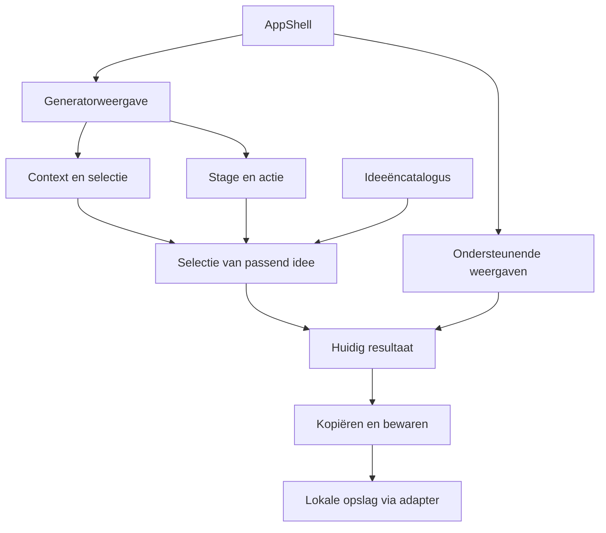

# Klets — ontwerpregels en blueprint

Versie 0.3 · 13 oktober 2026 · status: afgewerkt voorstel voor beoordeling, vóór implementatie.

Klets is de gekozen productnaam. Deze specificatie beschrijft een samenhangend systeem, de eerste appweergave en grenzen voor latere uitbreiding. Het bijbehorende HTML-bestand toont schematische layouts en ontwerpvoorbeelden. Het is een ontwerpdocument; de app en 3D-assets zijn nog niet gebouwd.

## 1. Productbeslissing

De kern is een speels ritueel voor twee: kies de situatie, geef de mascotte een tik, lees één passend idee en beslis zelf wat je ermee doet. De gebruiker zoekt inspiratie om initiatief, aandacht en verbinding vorm te geven binnen een volwassen D/s-dynamiek. De ontvangende partner moet een begrijpelijk bericht krijgen, zonder verborgen verplichting of onbekende spelregels.

Het eerste scherm dient één taak: een bruikbaar idee vinden. Latere functies krijgen ruimte via ondersteunende weergaven, terwijl de herkenbare kernhandeling behouden blijft.

### Vastgesteld en voorgesteld

| Status | Beslissing |
| --- | --- |
| Door gebruiker gevraagd | React; single page; standaardweergave zonder scroll; centraal bewegende billen; hand geeft een tik; vervolgens één idee; veel meer inhoud; verzorgde, speelse motion. |
| Door gebruiker gekozen | Zachte 3D-snoepvormen, cartoonbillen in een broekje, peach/lavendel en veeranimaties. |
| Nu gevraagd | Algemene ontwerpregels en een blueprint die toekomstige functies samenhangend ondersteunt. |
| Ontwerpvoorstel | 160 ideeën, vier categorieën; Samen/Op afstand; drie tonen; momentcheck; kopiëren; lokale favorieten. |
| Open vóór bouwen | Mockup vóór code of direct vanuit code; definitieve assets/fonts; hosting. |
| Latere opties | Eigen ideeën, initiatief vanuit beide rollen, gedeelde voorkeuren, punten/coupons, agenda of integraties. Geen van deze opties wordt nu alvast gebouwd. |

### Drie mogelijke structuren

| Structuur | Gevolg | Oordeel |
| --- | --- | --- |
| Generator met ondersteunende weergaven | Eén snelle kernhandeling, herkenbare verdieping en ruimte om uit te breiden. | Aanbevolen. |
| Dashboard met alle modules tegelijk | Veel functies onmiddellijk zichtbaar; kost ruimte en verzwakt de scrollvrije kern. | Past later eventueel bij een aparte overzichtstaak. |
| Verplichte contextwizard vóór ieder idee | Veel afstemming; voegt stappen toe bij herhaald gebruik. | Geschikt voor een eventuele eenmalige voorkeursinstelling. |

## 2. Algemene regels voor iedere ontwerpkeuze

| Regel | Gevolg in het ontwerp | Controle bij een nieuwe functie |
| --- | --- | --- |
| Eén hoofdhandeling per weergave | Het middelpunt trekt een idee; nevenacties hebben minder nadruk. | Kan iemand de eerstvolgende handeling onmiddellijk aanwijzen? |
| Passendheid vóór variatie | Eerst filteren op context, categorie en toon; daarna variëren. | Past elke nieuwe trekking bij de selectie die bij activering is vastgelegd? |
| Begrijpelijk voor beide rollen | Elke zin maakt doel, timing en omvang duidelijk waar dat nodig is. | Begrijpt de ontvanger het bericht zonder de app te kennen? |
| Voorstellen en werkelijkheid blijven gescheiden | Trekken, kopiëren en bewaren zeggen alleen iets over appgebruik. | Wordt een klik nergens gelezen als verzending, uitvoering of instemming? |
| Selectie en resultaat blijven herkenbaar | Actieve filters sturen de volgende tik; het resultaat toont de selectie van zijn eigen trekking. | Is duidelijk welke keuze het huidige idee opleverde en welke keuze straks geldt? |
| Beweging heeft betekenis | Iedere motion hoort bij contact, selectie, onthulling of terugkeer. | Welk resultaat bevestigt deze beweging? |
| Leesbaarheid blijft stabiel | De resultaatruimte verspringt niet; acties staan op vaste plekken. | Blijven tekst en knoppen zichtbaar bij de langste toegestane zin? |
| Diepte via één vast patroon | Verdieping gebruikt dezelfde ondersteunende weergave en terugkeer. | Herkent de gebruiker openen, sluiten en hervatten? |
| Uitbreiding gebruikt gedeelde begrippen | Nieuwe modules gebruiken bestaande context, ideeën en voorkeuren. | Introduceert deze functie een dubbel begrip of afwijkende betekenis? |
| Herstel is onderdeel van de functie | Fouten hebben een begrijpelijke status en bruikbare volgende actie. | Kan iemand doorgaan zonder een pagina te herladen? |
| Persoonlijke keuzes zijn omkeerbaar | Bewaren, aanpassen en een herinnering instellen hebben een terugweg. | Kan de gebruiker de wijziging terugvinden en herstellen? |

Nieuwe functies beschrijven vooraf: gebruikssituatie, primaire handeling, plek in de shell, gegevens die nodig zijn, effect op beide rollen, fout/herstel en motion. Pas daarna volgt een schermontwerp.

## 3. Relatie- en tekstregels

De app geeft inspiratie. Zij kan de beleving van de partner niet bepalen. Een nieuwe dynamiek vraagt duidelijke, kleine uitnodigingen en verzoekjes; de gebruiker kiest wat bij de gezamenlijke afspraken past.

- Een opdrachtje, plagerige aandacht, waardering en verlangen zijn verschillende intenties. Ze hebben geen automatische vervolgverplichting.
- Geen escalatie door vaker klikken, langere sessies, verzonnen stemming of vermeende gehoorzaamheid.
- Geen veronderstelling dat een late reactie moet worden goedgemaakt. Tijd om een activiteit te doen wordt duidelijk onderscheiden van een antwoordtermijn.
- Geen automatisch puntenverlies, streak voor gehoorzaamheid of cijfer dat de partner als persoon beoordeelt. Een gezamenlijk afgesproken puntensaldo voor concrete erkenning kan in een latere beloningsmodule zichtbaar zijn.
- Good Girl Points zijn een mogelijke afzonderlijke module voor bewuste erkenning achteraf. De reden blijft concreet; gewone waardering blijft beschikbaar zonder punten.
- Eigen initiatief en afstemmen kunnen beide een positieve plek krijgen. Een eventueel sub-perspectief heeft eigen keuzes en mag geen eenvoudige takenbak van de Dom worden.
- Geen vaste psychologische wachttijd of mathematische formule voor wanneer een nieuw verzoek gepast is. De momentcheck ondersteunt nadenken.
- Tekst is kort, natuurlijk Nederlands: één gedachte per zin, vaak 6–18 woorden. Een langere zin kan alleen als zij een noodzakelijke begrenzing duidelijk maakt.
- De eerste inhoudsset blijft niet-grafisch: kleine verzoekjes, flirten, nabijheid, waardering en speelse aandacht.
- De mascotte is gestileerd en gekleed. Zij vertegenwoordigt geen echte partner en deelt geen straf uit voor een reactie.

### Voorbeelden van de vier intenties

| Intentie | Voorbeeld | Wat het duidelijk maakt |
| --- | --- | --- |
| Opdrachtje | Als ik straks thuiskom, wil ik eerst een kus. | Kleine, begrijpelijke verwachting op een benoemd moment. |
| Plagen | Ja, ik zat naar je te kijken. | Speelse aandacht; geen taak. |
| Waardering | Ik moest lachen om je appje. Dat had ik even nodig. | Concrete waardering; geen score nodig. |
| Verlangen | Ik heb zin om je te kussen. | Uitgesproken verlangen; de app kent het antwoord niet. |

De 160 ideeën worden per intentie geschreven en inhoudelijk gecontroleerd. Synoniemen met dezelfde boodschap tellen niet als betekenisvolle variatie.

## 4. Informatiearchitectuur

### De blijvende shell

De shell beheert alleen de huidige weergave, de terugkeer en de gebruikersvoorkeuren. De drie vaste zones zijn bovenaan oriëntatie, centraal de huidige taak en onderaan ondersteunende acties.

| Zone | Eerste versie | Groei blijft hierin passen |
| --- | --- | --- |
| Oriëntatie | Werknaam; compacte instellingenknop. | Naam, accountstatus wanneer relevant, zichtbare terugkeer. |
| Context | Samen/Op afstand; toon en categorie. | Later aanvullende afgesproken voorkeuren via dezelfde instellingsweergave. |
| Kern | Interactief 3D-object; één inspiratie. | Andere ideeënsets en eventueel rolgebonden inspiratie met hetzelfde resultaatpatroon. |
| Hulpmiddelen | Kopiëren, bewaren, Past dit nu?, opgeslagen ideeën. | Eigen inhoud, gezamenlijke voorkeuren, erkenning en afspraken. |

De hoofdweergave heeft een compacte contextsamenvatting met een bewerkknop. Bij voldoende hoogte staan de vier categorieën als een 2×2-selectie boven de stage. Bij minder dan circa 640 px bruikbare inhoudshoogte wordt dat één 44 px hoge knop met de huidige categorie, bijvoorbeeld ‘Opdrachtje · Wijzigen’. Zij opent dezelfde categorieën in een ondersteunende selectie. Zo krijgt de mascotte op kleine schermen extra ruimte zonder kleinere hitboxes of verborgen geselecteerde toestand. Een categorie tik je direct aan; zij geldt meteen voor de volgende trekking. In de compacte selectie bevestigt de categorietik tegelijk de keuze en de terugkeer; sluiten zonder keuze behoudt de vorige categorie. Er is geen extra bevestigingsknop voor deze ene keuze. Situatie en toon worden samen in de contextweergave aangepast met bevestigen/annuleren: een voorlopige wijziging heeft geen effect op de generator tot zij bevestigd is.

De drie tonen zijn **Lief** (warm, uitnodigend), **Speels** (licht plagerig) en **Direct** (kort, beslist, binnen dezelfde afgesproken grenzen). Toon is een manier van formuleren, geen schaal voor seksuele intensiteit of verplichting. Een idee kan meerdere passende toonlabels hebben. Redactionele controle telt de werkelijk verschillende ideeën per combinatie van situatie, intentie en toon; veertig zinnen per intentie garanderen die dekking niet. Een aangeboden combinatie krijgt bruikbare inhoud of een eerlijk benoemde beperkte/lege reeks.

### Plek voor ondersteuning

Instellingen, opgeslagen ideeën en de momentcheck gebruiken hetzelfde paneelpatroon: titel, terug/sluiten, eigen taak, bevestiging indien nodig. Er staat één paneel tegelijk open. Op mobiel vervangt het paneel de centrale inhoud; op desktop gebruikt het een gecentreerde weergave binnen de shell. De generator is tijdens ondersteuning inactief. Focus gaat naar de paneeltitel; Terug, Escape en de browser-terugactie keren terug naar de aanroepende weergave en herstellen focus op de opener. Is die opener door een responsieve wissel verdwenen, dan gaat focus naar de teruggekeerde weergavetitel. Bewerken van context vanuit de momentcheck keert na bevestiging terug naar de momentcheck. De shell bewaart daarom een kleine terugkeerroute; er bestaan geen gestapelde zichtbare panelen. Alleen intern geopende ondersteunende weergaven voegen een navigatiestap toe; browser-terug op de normale generator wordt niet onderschept om iemand in de app vast te houden. Voorlopige instellingen worden bij annuleren verworpen. De paneelovergang is dezelfde rustige korte crossfade in alle modules.

De normale generator blijft zonder scroll. Lange toekomstige bibliotheken gebruiken paginering; korte panelen passen binnen de viewport. Wanneer grote tekst, zoom, een toetsenbord, landscape of een onverwacht kleine viewport meer ruimte vraagt, krijgt bereikbare inhoud voorrang en mag iedere weergave, ook de generator, scrollen. Geen verborgen clipping om een technische eis cosmetisch te halen. Versie 1 heeft Dom-side bediening; de sub heeft begrijpelijke ontvangen tekst. Zelfstandige bediening vanuit beide rollen wordt pas in een latere gebruikssituatie ontworpen.

## 5. Blueprint van de eerste weergave

Van boven naar beneden:

1. Compacte merkregel: Klets links, instellingen rechts.
2. Contextsamenvatting: bijvoorbeeld ‘Samen · Speels’, met ‘Aanpassen’.
3. Categorieën: Opdrachtje, Plagen, Waardering, Verlangen. Bij voldoende hoogte een 2×2-raster; op lage schermen één categorieknop. Standaard: Opdrachtje. ‘Alles’ kan later alleen worden toegevoegd als de mix nuttig blijkt.
4. 3D-stage: centraal, met de billen als groot aanraakvlak en de uitnodiging ‘Tik voor een idee’ bij eerste bezoek. De toegankelijke knopnaam blijft ‘Nieuw passend idee’, ook wanneer de getoonde zin verandert.
5. Resultaatgebied: een bescheiden intentielabel en één zin. Vóór de eerste tik staat hier uitleg op dezelfde plek.
6. Actierij: Kopiëren, Bewaren. Een tekstknop ‘Past dit nu?’ staat eronder.
7. Ondersteunende toegang: opgeslagen ideeën en eventuele status van de laatste eigen actie.

Desktop behoudt dit verticale ritueel. Extra breedte geeft het object en de tekst meer lucht; er komen geen extra taken naast het hoofdmoment.

### Ruimtebudget, als startpunt voor de bouw

Deze maten zijn voorgestelde ontwerpwaarden, geen gemeten browserresultaten. Hoogte is de resterende inhoudshoogte na browserchrome en veilige randen.

| Gebied | 320×568 compacte viewport | 390×844 viewport | 1440×900 viewport |
| --- | --- | --- | --- |
| Buitenruimte | 12 px | 20 px | 32 px |
| Oriëntatie + context | circa 76 px | circa 90 px | circa 100 px |
| Categorieën | Eén categorieknop van 44 px | 2×44 px, 8 px tussen rijen | maximaal 520 px breed |
| Stage | circa 164 px, flexibel | circa 270–300 px, flexibel | circa 300–340 px |
| Resultaat | circa 104 px inclusief context | circa 130 px | circa 130–150 px |
| Acties + momentcheck | circa 88 px | circa 88 px | circa 88 px |
| Overige ruimte | Verdeeld over kleine gaps; decoratie verdwijnt. | Ruime, rustige gaps. | Verticale compositie maximaal 600 px breed. |

De stage krimpt eerst nadat de compacte categorievariant is toegepast. Lettergrootte en hitboxes worden niet steeds kleiner gemaakt. Voor de compacte variant wordt de volledige 568 px als volgt gebudgetteerd: 24 px buitenruimte, 76 px oriëntatie/context, 44 px categorieknop, 164 px stage, 104 px resultaat inclusief contextlabel, 88 px resultaat-acties/momentcheck, 44 px toegang tot opgeslagen ideeën en 24 px overige gaps. Dat telt op tot 568 px. De twee actierijen en de toegang tot opgeslagen ideeën behouden ieder een 44 px hitbox; statusberichten gebruiken bestaande ruimte en verschijnen niet als extra rij. Wanneer tekst of veilige randen dit budget overschrijden, treedt de toegankelijke overflowregel in werking. Het latere browseronderzoek moet de totale som, lange teksten, veilige randen en browserchrome bevestigen; dit tabelbudget is geen bewijs van een geslaagde pasvorm.

## 6. Resultaat en toestand

De controller controleert bij activering eerst of er passende ideeën zijn. Bij nul kandidaten ontstaat geen trekking en geen contactanimatie: de lege toestand en ‘Selectie aanpassen’ verschijnen direct, terwijl een bestaand resultaat zijn eigen context behoudt. Pas een geldige trekking wordt als geaccepteerde tik behandeld. Die reserveert direct precies één idee en legt de selectie, getoonde tekst, intentie en actie-ID vast. Het contactmoment onthult dit voorbereide resultaat; filters die intussen veranderen gelden voor de volgende tik. Een wijziging van context houdt het bestaande resultaat zichtbaar met een expliciet label, bijvoorbeeld ‘Dit idee: Samen · Speels · Opdrachtje’. De contextsamenvatting krijgt bij verschil de toevoeging ‘Voor je volgende tik’. De app herschrijft de oude zin niet stilzwijgend.

Kopiëren, bewaren en momentcheck gebruiken een snapshot van het resultaat dat bij hun activering daadwerkelijk getoond wordt. Als een paneel opent of de tab verborgen raakt vóór contact, wordt de voorbereide trekking één keer afgerond en gepubliceerd voordat de decoratieve motion pauzeert. De knop komt bij terugkeer in een bruikbare rusttoestand; een geaccepteerde trekking gaat nooit verloren. Late callbacks zijn door de actie-ID onschadelijk.

| Toestand | Zichtbaar gedrag | Herstel of volgende actie |
| --- | --- | --- |
| Eerste bezoek | Korte uitleg waar later de zin staat; standaardselectie zichtbaar. Resultaat-acties zijn inactief met begrijpelijke uitleg. | Tik of wijzig selectie. |
| Rust | Laatste resultaat en keuzes blijven leesbaar. | Tik voor volgend passend idee. |
| Actie bezig | Hand en terugvering; bestaande inhoud blijft bereikbaar. | Extra tikken worden tot rust genegeerd; geen wachtrij. |
| Contactmoment | Het reeds gereserveerde idee wordt één keer gepubliceerd. | Onthulling begint; screenreader meldt de nieuwe zin eenmaal. |
| Kopiëren geslaagd | Tijdelijke status ‘Gekopieerd’. | Geen aanname van verzending. |
| Clipboard geweigerd | Zin blijft selecteerbaar; ‘Selecteer en kopieer de tekst’. | Handmatige kopie. |
| Geen passende ideeën | ‘Voor deze selectie heb ik nog geen nieuw idee.’ Een eventueel vorig resultaat blijft met zijn eigen context zichtbaar; zonder resultaat zijn acties inactief. | Directe actie ‘Selectie aanpassen’; nooit stilzwijgend verruimen. |
| Reeks doorlopen | Zelfde selectie krijgt een opnieuw gemengde reeks; laatste idee komt niet direct terug wanneer meer dan één idee past. | Gewoon doorgaan. |
| Opslag geweigerd | ‘Bewaard voor deze sessie’; favoriet blijft beschikbaar zolang de app open is. | Geen valse claim van blijvende opslag. |
| 3D niet beschikbaar | Statische, geklede fallback en dezelfde toegankelijke activering. | Ideeën blijven volledig bruikbaar. |
| Ondersteunend paneel open | Generator pauzeert; terugkeer bewaart selectie en idee. | Terug/sluiten. |

In een set met één passend idee is herhaling eerlijk onvermijdelijk; de app vermeldt ‘Enige idee in deze selectie’. Andere filters worden niet zonder keuze toegevoegd.

Opgeslagen ideeën hebben een lege toestand ‘Je hebt nog geen ideeën bewaard’, met ‘Terug naar inspiratie’. Versie 1 bewaart één favoriet per idee-ID. Na bewaren verandert de actie in ‘Bewaard’, herkenbaar door tekst én een vinkje; opnieuw activeren meldt ‘Dit idee is al bewaard’ en maakt geen duplicaat. De oorspronkelijke snapshot blijft behouden. Verwijderen gebeurt expliciet in de opgeslagen weergave, meldt welk idee is verwijderd en biedt tijdelijk ‘Ongedaan maken’. Een sessiefavoriet wordt ‘Bewaard voor deze sessie’ genoemd. Geen enkele opslag- of clipboardmelding schuift naar een ander resultaat wanneer dat later verschijnt; de melding hoort bij de eigen actie en haar snapshot.

## 7. Momentcheck: ‘Past dit nu?’

Dit is een optionele denkhulp bij het gekozen idee. De app interpreteert geen antwoord namens de partner en geeft geen groene toestemmingsbadge.

Het paneel toont het huidige idee met drie reflectievragen:

1. Heeft ze nu ruimte en, waar nodig, privacy?
2. Is er speelse aansluiting, of zou ik eerst even contact maken?
3. Alleen bij een opdrachtje: heb ik al iets gevraagd waarop nog geen antwoord kwam? Bij plagen of verlangen: past deze toon bij ons contact van nu? Bij waardering: benoem ik iets concreets dat ik werkelijk waardeer?

Daaronder staan ‘Terug naar idee’, ‘Bewaren voor later’, ‘Ander idee’ en, waar zinvol, ‘Eerst afstemmen’. Bewaren bevestigt de opslagstatus en keert terug; ander idee keert terug en start één trekking binnen dezelfde selectie. Afstemmen toont alleen een zin die bij de intentie hoort: bijvoorbeeld ‘Heb je zin in een klein opdrachtje?’ bij een opdrachtje of ‘Zin om even samen te zitten?’ bij nabijheid. Bij waardering is deze extra zin niet nodig en staat de actie er niet. Ook een check-in wordt uitsluitend op eigen keuze gekopieerd.

‘Ander idee’ blijft binnen dezelfde selectie. Wie een andere toon wil, kiest ‘Toon aanpassen’ in de contextweergave. Checkantwoorden worden in versie 1 niet opgeslagen of als profiel van de partner gebruikt.

## 8. Visueel systeem

### Voorgestelde tokens

De gekozen materiaalwereld staat vast als richting. Exacte waarden hieronder zijn een consistente startset die bij implementatie op leesbaarheid en weergave wordt gecontroleerd.

| Token | Voorstel | Gebruik |
| --- | --- | --- |
| background | #FFF1E8 | Rustige hoofdachtergrond. |
| surface | #FFFAF6 | Ondersteunende panelen en subtiele selectieachtergrond. |
| ink | #44283F | Primaire tekst, focus en nadruk. |
| ink-muted | #765866 | Uitleg en context; contrast controleren per achtergrond. |
| peach | #F4B7A7 | Mascotte en decoratief materiaal. |
| lavender | #B8A2E8 | Broekje en zacht geselecteerde vlakken met donkere tekst. |
| lavender-strong | #6E4B9D | Actieve lijnen of accenten waar meer contrast nodig is. |
| line | #D9C9CE | Rustige scheiding en grens van controles. |
| spacing | 4 / 8 / 12 / 16 / 24 / 32 / 48 px | Één schaal voor gaps en padding. |
| radius-control | 16 px | Gewone controles. |
| radius-panel | 24 px | Ondersteunende weergave. |
| radius-pill | 999 px | Korte selectie en filter. |
| target | minimaal 44×44 px | Voorgestelde hitbox voor primaire bediening. |
| focus | 2 px pruimlijn, 3 px offset | Toetsenbordfocus; herkenbaar op ieder vlak. |

### Typografie en hiërarchie

Kandidaat: Fraunces voor display en inspiratie; Nunito Sans voor bediening. Gebruik lokale bundeling en goede systeemfallbacks wanneer de letters later worden gekozen. Inspiratie is circa 22–30 px, afhankelijk van hoogte/breedte, met circa 1.25–1.35 regelafstand. Body en bediening beginnen rond 16 px. Korte labels mogen 14 px zijn als ze leesbaar blijven. Geen kleine kapitale paragrafen of decoratieve lettervormen voor de te kopiëren tekst.

### Componentcontracten

| Component | Eigen verantwoordelijkheid | Vaste regels |
| --- | --- | --- |
| AppShell | Weergave, terugkeer en veilige randen. | Bewaart de generator bij ondersteuning; geen eigen selectiealgoritme. |
| ContextSummary / ContextPanel | Situatie en toon zichtbaar maken en aanpassen. | Een bevestigde verandering geldt voor de volgende trekking. |
| IntentSelector | De categorie kiezen. | Eén actieve categorie; tekst én vorm tonen selectie; één tik kiest direct, zonder extra bevestiging. |
| PlayStage | Visueel ritueel en één activeringsgebeurtenis. | Canvas decoratief; echte knop; geeft geen inhoudelijke betekenis aan beweging. |
| InspirationResult | Eén zin, label en oorspronkelijke selectie. | Selecteerbare tekst; vaste ruimte; één live announcement. |
| ResultActions | Kopiëren en bewaren van het huidige resultaat. | Onafhankelijk van 3D; iedere actie meldt haar eigen status. |
| RoomCheckPanel | Reflectievragen en eigen vervolgstappen. | Geen stemmingprofiel, score of automatische toestemming. |
| SavedIdeasView | Bewaarde ideeën bekijken en verwijderen. | Dezelfde resultaatweergave; duidelijke lege toestand en terugkeer. |
| StatusMessage | Actieresultaat of fout uitleggen. | Geen verstorende modal voor een kleine fout; tekst naast de relevante actie. |

Een nieuwe component krijgt standaard-, focus-, geselecteerde-, bezig-, lege- en fouttoestanden waar die werkelijk bestaan. Geen losse aangepaste knoppen per module.

## 9. Motioncontract

De betekenisvolle zichtbare gebeurtenis is het contactmoment. De generatorcontroller reserveert het resultaat bij activering; de zichtbare onthulling en het optionele geluid verwijzen naar contact. Bij verborgen tab of het openen van ondersteuning publiceert de controller het resultaat eenmaal zonder geluid en beëindigt de decoratieve routine. De totale routine duurt als richtwaarde circa 600 ms.

| Tijd | Gebeurtenis | Gedrag |
| --- | --- | --- |
| 0–60 ms | Directe reactie | Idle stopt soepel; klein indrukken van het object. |
| 40–150 ms | Hand nadert | Eén hand beweegt naar de buitenzijde van het broekje. |
| 150–190 ms | Contact | Lokaal of groepsgewijs squashen; klein kantelen; voorbereid idee één keer publiceren. |
| 190–275 ms | Terugtrekken | Hand trekt weg; object begint zachte rebound. |
| 240–420 ms | Onthulling | Tekst verschijnt met beperkte opacity en circa 6 px verplaatsing. |
| 275–600 ms | Rust | Twee afnemende rebounds; knop wordt na herstel opnieuw actief. |

- Rustbeweging: ongeveer 6 seconden per kleine wiebel, geen voortdurende aandachtsvraag rond de tekst.
- Beweging kan onafhankelijk van geluid worden uitgezet in instellingen. De systeemvoorkeur voor reduced motion bepaalt de eerste bewegingskeuze; de gebruiker kan beweging altijd pauzeren. Een gepauzeerde mascotte houdt dezelfde knop en geeft direct een resultaat met hooguit een rustige crossfade.
- Geen cameraschudden, full-screen blur of voortdurend confetti.
- Reduced motion: geen idle/travel/rebound; directe trekking met korte crossfade en eventueel statisch contactteken.
- Geluid begint uit; alleen een expliciete keuze zet het aan. Geen autoplay.
- Animatie stopt bij verborgen tab en bij ondersteunende weergaven.
- Audiofouten verhinderen geen trekking en produceren geen foutmodal; geluid blijft een optionele extra. Dezelfde reduced-motionkeuze geldt voor paneelovergangen en eventuele scrollanimatie.
- De belangrijkste eventlogica hangt niet alleen af van een CSS animationend-callback. De trekking is ook bij uitgeschakelde motion deterministisch één actie.
- De 3D-weergave gebruikt een beperkte scene en renderbudget; de exacte techniek wordt pas in het implementatieplan definitief.

## 10. React- en gegevensblueprint

De bouw scheidt vier verantwoordelijkheden: inhoud, selectie, weergave en opslag. De animatie kent de teksten niet; de selectie kent geen Three.js-objecten. Een toekomstige puntenmodule leest een expliciet door de gebruiker gekozen erkenning, geen tik-events.

Eén generatorcontroller bezit de huidige selectie, de lopende trekking, het getoonde resultaat en de gemengde reeksen. De stage ontvangt alleen de animatiestatus en geeft activering door. De controller zorgt met een unieke actie-ID voor één reservering en één publicatie; daarvoor is geen externe state-library nodig. Kleine tijdelijke weergavetoestand blijft lokaal in de betreffende component.

### Gedeelde begrippen

| Begrip | Minimum aan betekenis | Toekomstige compatibiliteit |
| --- | --- | --- |
| Idea | Stabiele ID, tekst, intentie, geldige situaties, toonlabels, redactiestatus, optionele duur/privacyvoorwaarde. | Eigen ideeën en vertalingen hoeven de generator niet te wijzigen. |
| Selection | Gekozen situatie, toon en intentie. | Nieuwe voorkeuren zijn benoemde velden, geen reeks ongecontroleerde flags. |
| CurrentDraw | Idee-ID, actie-ID, tekst- en intentiesnapshot, contextsnapshot en moment van trekken. | Kopiëren, bewaren en momentcheck blijven dezelfde tekst gebruiken bij cataloguswijziging. |
| Favorite | Idee-ID plus tekstsnapshot, context en opgeslagen moment. | Wijzigingen in de catalogus herschrijven persoonlijke favorieten niet. |
| Preferences | Eigen toon/contextkeuzes, motion/soundkeuze en expliciete contentvoorkeuren. | Geen afgeleide profielscore van de partner. |
| Recognition, later | Persoonlijke reden, expliciet gekozen punten indien gebruikt, moment, wijzigbare invoer. | Afzonderlijk van Idea en CurrentDraw; eigen historie en afspraken. |
| Agreement, later | Gezamenlijke omschrijving, betrokkenen, bevestigde staat en wijzigingsgeschiedenis. | Een eenzijdige notitie wordt niet automatisch een gezamenlijke afspraak. |

Versie 1 heeft versieerbare lokale opslag met gecontroleerd lezen, een migratiepad en een sessiefallback. Een onbekende of onleesbare opgeslagen versie wordt niet stilzwijgend overschreven; de bruikbare sessie gaat door met een begrijpelijke melding. De adapter kan later synchronisatie ondersteunen; accounts, cloudservices en realtime infrastructuur worden niet alvast gebouwd. Browseropslag wordt niet als versleutelde of voor medegebruikers onzichtbare opslag gepresenteerd.

### Selectievolgorde

1. Neem alleen vrijgegeven ideeën uit de catalogus.
2. Filter op de expliciet gekozen situatie, intentie en toon. Tijd/privacyvoorwaarden zonder eigen filter worden zichtbaar benoemd in de tekst of momentcheck; zij worden niet geacht al vervuld te zijn.
3. Gebruik per genormaliseerde selectie en catalogusversie een gemengde reeks van stabiele idee-IDs. Bij cataloguswijziging wordt de beschikbare reeks vernieuwd en bevat zij geen verwijderde of niet-vrijgegeven IDs.
4. Reserveer één resultaat per geaccepteerde actie en publiceer dat eenmaal.
5. Meng opnieuw wanneer de reeks op is; vermijd het laatst getoonde idee, ook na wisselen van filters, als meerdere ideeën beschikbaar zijn. Als de laatste ID alsnog aan het einde van de reeks staat, start de nieuwe cyclus met een andere ID; variatie gaat hier vóór een starre reeksvolgorde.
6. Bij nul resultaten toon een lege toestand; bij één resultaat benoem de beperkte variatie.

De initiële defaults zijn herkenbaar en aanpasbaar. Na een eigen wijziging bewaart de app die keuze. ‘Samen’ is een filterkeuze van de gebruiker en geen locatie- of nabijheidsmeting.

## 11. Groei zonder aangeplakte functies

| Fase | Functie | Integreert met | Voorwaarde vóór bouwen |
| --- | --- | --- | --- |
| 1 | Generator, context, vier intenties, 160 ideeën, kopiëren, favorieten en momentcheck. | Kerncomponenten en lokale voorkeuren. | Geschreven ontwerp en implementatieplan beoordeeld. |
| 2 | Eigen ideeën, bewerken, blokkeren van ongewenste inhoud, zoeken in opgeslagen ideeën. | Idea-model, catalogus en dezelfde resultaatweergave. | Werkelijke behoefte aan personalisatie; duidelijke verwijdering en herstel. |
| 3 | Inspiratie vanuit de sub en gezamenlijke voorkeuren. | Bestaande intenties en voorkeuren met expliciete eigenaarschap. | Zelfstandig ontworpen sub-gebruikssituatie; geen automatisch afgeleid rollenprofiel. |
| 4 | Good Girl Points en coupons. | Afzonderlijke Recognition- en Reward-begrippen; gedeelde UI-primitieven. | Samen begrepen regels, correcties en inwisselen; geen automatische koppeling aan verzoekjes. |
| 5 | Afspraken, herinneringen of een lichte planning. | Agreement-model en eigen overzichtstaak. | Verschil tussen voorstel, eigen notitie en gezamenlijke afspraak vastgelegd. |
| 6 | Synchronisatie of Telegram-integratie. | Opslagadapter en expliciete deelactie. | Accounts, eigenaarschap, toegang, verwijdering en specifieke verzendautorisatie ontworpen. |

De fasen zijn opties, geen toegezegde roadmap. Nieuwe modules krijgen pas een permanente navigatieplek zodra hun eigen taak vaak genoeg voorkomt. Het generator-scherm krijgt geen puntenmeter, afsprakenlijst en beloningswinkel erbij.

## 12. Toetsing en besluitvorming

### Acceptatie van de eerste bouw

- Kernhandeling en laatst getrokken resultaat zijn begrijpelijk zonder uitleg.
- Elke nieuwe trekking past bij de selectie die bij haar activering is vastgelegd; het getoonde resultaat benoemt zijn oorspronkelijke context. Lege en één-itemselecties werken eerlijk.
- Eén geaccepteerde tik produceert één idee, ook met reduced motion en herhaalde input.
- Een lege selectie toont direct een herstelactie, zonder lege trekking, contactgeluid of verbruik van de ideeënreeks. Een categorie verandert in één keuze de volgende trekking; contextwijzigingen hebben afzonderlijk bevestigen/annuleren.
- Normale hoofdweergave past in de doelviewports; zoom en grote tekst houden inhoud bereikbaar.
- De compacte categoriekeuze geeft de mascotte ruimte; wisselen tussen compacte en ruime layout behoudt selectie, resultaat en focus.
- Kopiëren, weigering van clipboard/opslag, terugkeer en verwijderen van favorieten hebben een bruikbaar pad.
- Toetsenbordbediening, focus, tekstcontrast, labels en live announcements werken met dezelfde inhoud.
- Annuleren bewaart bevestigde filters; browser-terug werkt binnen ondersteuning en verlaat de generator normaal wanneer er geen interne terugkeerroute openstaat. Beweging kan worden gepauzeerd.
- De momentcheck kent geen partnerstatus of toestemmingsscore.
- Een favoriet en een gekopieerd bericht worden nergens als uitgevoerd of verzonden weergegeven.
- Mobiel en desktop worden samen visueel beoordeeld, gevolgd door één gebundelde correctieronde indien nodig.

Deze punten zijn eisen voor de latere bouw. De huidige blueprint is inhoudelijk en structureel beoordeelbaar; geen enkel punt is nu als browsergetest of geïmplementeerd geclaimd.

### Beslisvolgorde voor volgende werkzaamheden

1. Beoordeel dit ontwerpfundament en pas de regels waar nodig aan.
2. Bepaal mockup vóór code of direct vanuit code, plus hosting indien die de bouw stuurt.
3. Maak een gefaseerd implementatieplan voor versie 1 met afgesproken componentgrenzen.
4. Bouw versie 1 en verifieer de gebruikspaden binnen de afgesproken scope.
5. Gebruik feedback om één volgende functie te kiezen; toets die aan dezelfde regels.

### Zelfreflectie

Het eerdere ontwerp legde meer vast over het billenobject dan over het resultaat en de ontvangende partner. Deze blueprint herstelt dat met context, duidelijke intenties, een optionele momentcheck en gescheiden betekenissen van trekken, bewaren, waarderen en afspreken. Het grootste resterende risico is dat veel inhoud alsnog herhalend of onnatuurlijk klinkt. Daarom bepaalt redactionele kwaliteit of een idee in de catalogus komt; 160 is een doel, geen reden om zwakke varianten op te nemen.

Geschatte betrouwbaarheid: circa 90% voor deze ontwerp- en architectuurbeoordeling, subjectief. Passendheid voor beide partners en de daadwerkelijke viewportpasvorm moeten tijdens beoordeling en gebruik nog worden bevestigd.

## 13. Mini-audit van de afwerking

Scope: dit ontwerpdocument en de schematische HTML-blueprint. Er is geen React-app gebouwd; runtimegedrag, 3D, echte tekstzoom en browserpasvorm zijn daarom geen bewezen resultaten. De afwerking gebruikt één bevindingenronde, één gebundelde correctie en een eindcontrole. Nieuwe smaakvarianten worden niet als defect behandeld.

| Bevinding | Gerichte correctie | Bewijs op ontwerpniveau |
| --- | --- | --- |
| Een stage van 112 px verzwakte het centrale object op lage schermen. | Lage layouts krijgen één 44 px categorieknop; de stage groeit naar 164 px. | Het volledige compacte ruimtebudget telt opnieuw op tot 568 px, met dezelfde acties en hitboxes. |
| Permanente rustbeweging kon alleen via de systeemvoorkeur worden vermeden. | Onafhankelijke bewegingskeuze en pauze; hetzelfde resultaatpad zonder travel of rebound. | Motion- en acceptatiecontract benoemen de pauzestand en reduced-motiongedrag. |
| Terugkeer kon focus verliezen wanneer de opener bij een layoutwissel verdween. | Weergavetitel als focusfallback; geen onderschepping van browser-terug op de generator. | Het gedeelde paneelcontract specificeert opener, fallback en interne navigatie. |
| Voorlopige contextwijzigingen hadden geen expliciete annulering. | Pas bevestiging wijzigt de generator; annuleren verwerpt tijdelijke keuzes. | Context- en paneelcontract gebruiken hetzelfde bevestigen/annulerenpatroon. |
| Een bewaaractie liet de bestaande favoriet onvoldoende zien. | ‘Bewaard’/‘Bewaard voor deze sessie’, één favoriet per ID, expliciet verwijderen. | Resultaattoestand en opslagbetekenis zijn consistent beschreven. |

### Behouden om regressie te voorkomen

React als framework, geklede 3D-snoepmascotte, peach/lavendel, één geaccepteerde tik per idee, vier intenties, drie tonen, contextgebonden selectie, onafhankelijke momentcheck, handmatig kopiëren en de afzonderlijke toekomstmodules blijven intact. De canonieke hoofdstructuur is niet vervangen.

### Hercontrole v0.3

| Gevonden spanning | Correctie | Eindcontrole |
| --- | --- | --- |
| De categorieknoppen suggereerden direct kiezen, terwijl de tekst voor alle keuzes extra bevestiging voorschreef. | Categorieën kiezen met één tik; alleen de contexteditor bewaart voorlopige situatie/toon tot bevestiging. | Ruime en compacte weergave gebruiken dezelfde directe selectiesemantiek; terug zonder keuze behoudt de categorie. |
| ‘Elke geaccepteerde tik reserveert één idee’ had geen expliciete route bij nul kandidaten. | Kandidatencontrole gaat vooraf aan acceptatie; een lege selectie toont direct herstel zonder contactanimatie. | Geen idee-ID, contactgeluid of reeksverbruik zonder resultaat; het vorige resultaat blijft begrijpelijk. |
| Een algemeen verbod op een zichtbaar cijfer kon botsen met de geplande puntenmodule. | Persoonlijke beoordeling onderscheiden van een samen afgesproken erkenningssaldo. | De toekomstige puntenmodule behoudt haar plek en blijft los van automatische trekking of uitvoering. |

Deze hercontrole corrigeert alleen interactiecontracten en één te ruime formulering. Kleuren, componentgrenzen, maten, animatietiming en features zijn behouden. Na de gerichte eindcontrole is verdere afwerking van de specificatie niet nodig zonder nieuwe feedback of een concrete implementatiebevinding.

### Eindcontrole en resterende verificatie

Documentstructuur, inhoudsankers, archiefinhoud, tokengebruik in het HTML-document en de benoemde tekstkleurcombinaties zijn lokaal gecontroleerd. De blueprint heeft 13 hoofdsecties met geldige ankers. De compacte ruimteverdeling en de schematische variant tellen beide op tot 568 px. De vijf gecontroleerde tekstkleurcombinaties hebben berekende contrastverhoudingen van 5,66:1 tot 12,50:1; dit is een kleurcontrole en geen certificering van de nog te bouwen interface. De HTML-weergaven zijn schema’s met duidelijke placeholderlabels. Browserrendering is in deze omgeving niet beschikbaar; daadwerkelijke pasvorm en interactieve toegankelijkheid worden tijdens implementatie geverifieerd. De 160 ideeën zijn een redactioneel doel en staan nog niet als volledige catalogus in dit ontwerpdocument. Er is geen ontbrekende implementatie als een geslaagde test gepresenteerd.
